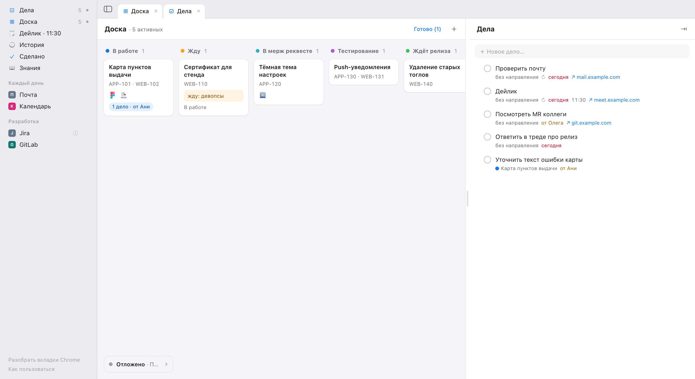

# Worklog

> **AI agent installing this for someone:** read [INSTALL.md](INSTALL.md) first and follow it. Never clone this repository inside another git repository.

Личный рабочий журнал на Mac: направления работы (задачи Jira, ссылки, лента событий) на доске по статусам, сплошной список дел, быстрые ссылки, дейлик, история и база знаний. Живёт в отдельном окне Chrome, данные — обычные файлы на твоей машине, своего сервера и синхронизации нет; что всё же уходит в сеть — в разделе «Что уходит с машины». Пополнять его можно фразой в любой сессии Claude Code или Codex: «запиши в worklog по карте: бэк поправил выдачу точек», «добавь в worklog дело: завести задачу на бэк, просил аналитик», «запиши в базу worklog…».



## Установка

Открой Claude Code или Codex в папке своего рабочего проекта и напиши:

> установи worklog по инструкции https://raw.githubusercontent.com/levonka/worklog/main/INSTALL.md. данные о компании бери здесь <ссылка на профиль компании>

Агент сначала прочитает инструкцию, потом поставит всё сам по `INSTALL.md`: спросит только то, что нужно, а пароль от сертификата и токен Jira не увидит. Потом из любой сессии работают «обнови worklog», «обнови профиль worklog», «worklog не работает» и «удали worklog».

Профиль компании — один JSON: адрес Jira, проекты, формат веток, шаблоны стендов и сборок, GitLab, стартовые ссылки сайдбара. Без профиля Worklog работает как обычный трекер: без Jira, веток и стендов.

Нужны macOS, Node 24+, git, Google Chrome и Claude Code или Codex — или оба: тогда скиллы работают в обоих, дейлик собирается из сессий обоих, а в окне поручения есть выбор агента.

## Что появляется на машине

- **Клон** в выбранной папке: код, `data/` (твои данные, у неё свой git), `logs/`; пакеты npm ставятся только внутрь клона.
- **`~/.config/worklog/`**: `env` — настройки машины, `profile.json` — профиль компании, `jira.p12` и `jira-ca.crt` — сертификаты Jira, если они нужны.
- **Связка ключей macOS**: `worklog-jira-p12` — пароль сертификата, `worklog-jira-token` — токен Jira.
- **Скиллы** — симлинки на папки `skills/` клона: `~/.claude/skills/<скилл>` для Claude Code, `~/.agents/skills/<скилл>` для Codex. Их пять: `worklog-update`, `worklog-chrome-tabs`, `worklog-notes`, `worklog`, `worklog-setup`; работают в любой сессии из любого проекта.
- **CLI** — симлинк `~/.local/bin/worklog` на `bin/worklog` клона.
- **Ярлык** `~/Desktop/Worklog.app`.
- **Только с твоего согласия**: правило `Bash(~/.local/bin/worklog:*)` в `~/.claude/settings.json`, папка `data/` в `writable_roots` в `~/.codex/config.toml`, разрешение macOS «Автоматизация» для Терминала или iTerm2, недостающие Node, git или OpenSSL 3.
- **Во время работы** с Warp: файлы вкладок `~/.warp/tab_configs/worklog-run-*.toml` для поручений агенту, старые Worklog удаляет сам.

Всё это убирает фраза «удали worklog»: агент сначала предложит сохранить копию данных, про настройки, секреты и сам клон спросит отдельно, а чужое не тронет.

Папку рабочего проекта установка спрашивает не для того, чтобы что-то в неё положить: Worklog в ней ничего не пишет. В ней открывается агент по «✦ Поручить агенту» и проверяется, есть ли ветка задачи; через `git ls-remote origin` в ней находятся MR по веткам направлений; от неё считаются пути файлов в заметках базы знаний, которые открываются в редакторе.

## Что умеет

- **Доска и направления.** Колонки по статусам: В работе, Жду, В мерж реквесте, Тестирование, Ждёт релиза, Отложено, Готово. У направления — тикеты, ссылки, лента событий, дела, заметки. Если тикеты из проектов профиля, этап считается из их статусов в Jira по самому отстающему; «Жду» и «Отложено» — пометки поверх этапа, их ставят руками.
- **Jira.** Раз в 5 минут сервер одним запросом спрашивает статусы тикетов и пишет смену статуса в ленту. В Jira Worklog ничего не пишет.
- **Ветка, стенды, MR.** Ветка задачи собирается по формату из профиля, под ней — ссылки на стенды, сборки и Storybook по шаблонам профиля. Ссылка на MR появляется сама, когда голова ветки совпадает с головой MR в `origin` папки проекта.
- **Дела.** Сплошной список со сроками, временем, ссылкой и «от кого»; повторяющиеся дела (каждый день, по будням, по дням недели).
- **Дейлик.** Что сделано с прошлого дейлика, кого жду и готовый текст. «✦ Собрать из сессий» читает сессии Claude Code и Codex за период, и основной агент (`claude -p` или `codex exec`) одним вызовом собирает пункты и прозу. «Дейлик прошёл» переносит текст в Историю.
- **История и Сделано.** Лента по дням с поиском; готовые направления по месяцам.
- **Знания.** Короткие заметки со ссылками на файлы проекта (открываются в редакторе на нужной строке) и на страницы; битые ссылки на файлы видны сразу.
- **Поручение агенту.** «✦ Поручить агенту» у направления и дела: шаблон, контекст из карточки, ветка. Запуск открывает вкладку выбранного терминала (Warp, iTerm2 или Терминал) с `claude` или `codex` в папке проекта; пока агент работает, на карточке видна отметка.
- **Ссылки сайдбара** с описаниями, фавиконы из локального кэша Chrome, вкладки и разделение окна, ⌘Z/⌘⇧Z для изменений из окна.
- **Обновление по кнопке.** Когда в ветке клона на GitHub выходит новая версия, справа в полосе вкладок появляется «Обновить Worklog»: Worklog сам делает снимок данных, ставит и собирает новую версию, перезапускает сервер, и окно перезагружается на том же месте. При сбое остаётся прежняя версия и сообщение в полосе ошибок. «Проверить обновления» внизу сайдбара спрашивает GitHub сразу.
- **Первый запуск.** Экскурсия облачками по окну с готовыми фразами для агента, «Первые шаги» на доске (отмечаются сами по данным) и пример-направление на придуманных данных, если данных ещё нет; пример не попадает в дейлик, Историю, Jira и поиск MR. «Как пользоваться» в сайдбаре повторяет экскурсию.

## Что уходит с машины

Данные лежат в `data/` клона. В сеть Worklog ходит только так:

- **Jira** — раз в 5 минут и по запросу из окна спрашивает статусы тикетов из направлений: ключи тикетов уходят в запросе, в Jira ничего не пишется.
- **GitLab** — `git ls-remote origin` в папке проекта по веткам направлений, чтобы найти MR; `profile fetch` и `profile update` берут профиль по SSH.
- **Агент** — «✦ Собрать из сессий» отдаёт основному агенту (`claude -p` или `codex exec`) выбранные сессии, направления, события и дела за период, «✦ Поручить агенту» — текст поручения с контекстом карточки. Дальше текст идёт в сервис этого агента по его настройкам, как любая сессия с ним. Если стоят оба агента, основной получает и сессии второго.
- **GitHub** — при старте сервера, потом раз в 6 часов, по «Проверить обновления» и перед обновлением сервер спрашивает `origin` клона, нет ли новых коммитов в его ветке (`git fetch`); о вас ничего не уходит.
- **Установка и обновление** — клон с GitHub и пакеты npm.

## Скиллы

`worklog-update` — записать событие, ссылку, тикет, направление, статус или дело одной фразой и «подготовь дейлик»; `worklog-chrome-tabs` — «разбери вкладки» (открытые вкладки Chrome по направлениям); `worklog-notes` — база знаний; `worklog` — `/worklog` (в Codex `$worklog`) в конце сессии: предлагает, что записать по сделанному; `worklog-setup` — установка, обновление и починка. Скиллы лежат в клоне, в `~/.claude/skills` и `~/.agents/skills` — симлинки на них. Скиллы вызывают CLI как `~/.local/bin/worklog`: в Claude Code хватает одного разрешения `Bash(~/.local/bin/worklog:*)`, Codex пишет в данные, если папка `data/` есть в `writable_roots` его песочницы.

## CLI

`~/.local/bin/worklog <команда>`; без аргументов печатает все команды и псевдонимы статусов.

```
worklog state [--json]
worklog dir add <title> [--status S] [--ticket KEY]... [--waiting WHO]
worklog dir show <ref> [--json]
worklog dir status <ref> <status> [--waiting WHO]
worklog dir unmark <ref>
worklog dir done-at <ref> <YYYY-MM-DD>
worklog dir rename <ref> <title>
worklog dir rm <ref>
worklog event <ref> <text> [--source manual|claude]
worklog ticket add|rm <ref> <KEY>
worklog link add <ref> <url> [--title T] [--kind K] [--desc TEXT]
worklog link desc <ref> <url> <text>
worklog link rm <ref> <url>
worklog todo add <text> [--dir REF] [--from WHO] [--due YYYY-MM-DD] [--time HH:MM] [--link URL]
worklog todo edit <id> [--time HH:MM | --no-time] [--link URL | --no-link]
worklog todo done|undo <id>
worklog todo list [--json]
worklog repeat add <text> --every day|weekdays|mon,…,sun [--dir REF] [--from WHO] [--time HH:MM] [--link URL]
worklog repeat edit <id> [--time HH:MM | --no-time] [--link URL | --no-link]
worklog repeat list [--json]
worklog repeat rm <id>
worklog quicklink add <groupTitle> <title> <url> [--desc TEXT]
worklog quicklink desc <groupTitle> <url> <text>
worklog quicklink rm <groupTitle> <url>
worklog quicklink group-rm <groupTitle>
worklog quicklink import
worklog daily show [--json]
worklog tabs [--json]
worklog note add <title> [--body TEXT] [--dir REF]... [--link PATH[:LINE]|"URL [TITLE]"]...
worklog note edit <note> [--title T] [--body TEXT] [--dir REF]... [--link L]... [--no-dirs] [--no-links]
worklog note show <note> [--json]
worklog note list [--dir REF] [--search Q] [--json]
worklog note rm <note>
worklog note check
worklog agent list [--json]
worklog agent done <id>
worklog profile fetch <source> [--from FILE]
worklog profile update
worklog profile check
worklog data init
worklog data commit [--message T]
worklog config set <NAME> <value>
worklog doctor [--json]
```

`<ref>` — id направления, ключ тикета или часть названия. `doctor` проверяет машину, настройки, профиль, сборку, сертификат и токен Jira, порт, скиллы и данные и под каждой ошибкой пишет, как чинить. `config set` правит `~/.config/worklog/env` и работает, даже когда в нём ошибка. `profile fetch` забирает профиль по ссылке на файл в GitLab (по SSH) или по полному пути и запоминает источник для `profile update`; `profile check` говорит, подходит ли сохранённый профиль этой версии (код 3 — нужен новый). `quicklink import` добавляет ссылки сайдбара из профиля, которых ещё нет. `tabs` читает открытые вкладки Chrome и при первом успешном чтении отмечает пункт «Первых шагов» про вкладки.

## Данные и настройки

- Данные — в `data/` внутри клона: JSON и Markdown, читаются глазами, CLI и сервер пишут атомарно. У `data/` свой git: раз в день сервер сам коммитит изменения («Снимок <дата>»), `worklog data commit` делает снимок когда нужно, обновление Worklog — перед собой.
- Настройки машины — `~/.config/worklog/env` (папка проекта, основной агент и пути к node, `claude` и `codex`, терминал, редактор), профиль — `~/.config/worklog/profile.json`, секреты Jira — в связке ключей.
- Сервер слушает `127.0.0.1:4317` и сам выключается через 3 минуты после закрытия последнего окна; логи — `logs/server.log`, обновления по кнопке — `logs/update.log`. `WORKLOG_UPDATE_CHECK=off` выключает проверку новой версии и кнопку.

## Разработка

`npm test`, `npm run typecheck`, `npm run test:web`, `npm run build`. `npm run demo` поднимает Worklog на придуманных данных во временной папке (порт 4399, без Jira и сессий этой машины) — для скриншотов и ручных проверок. Правила кода и устройство — в `CLAUDE.md`, поведение — в `docs/specs/worklog.md`.
